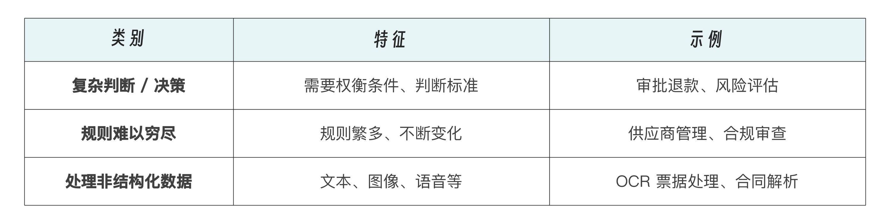
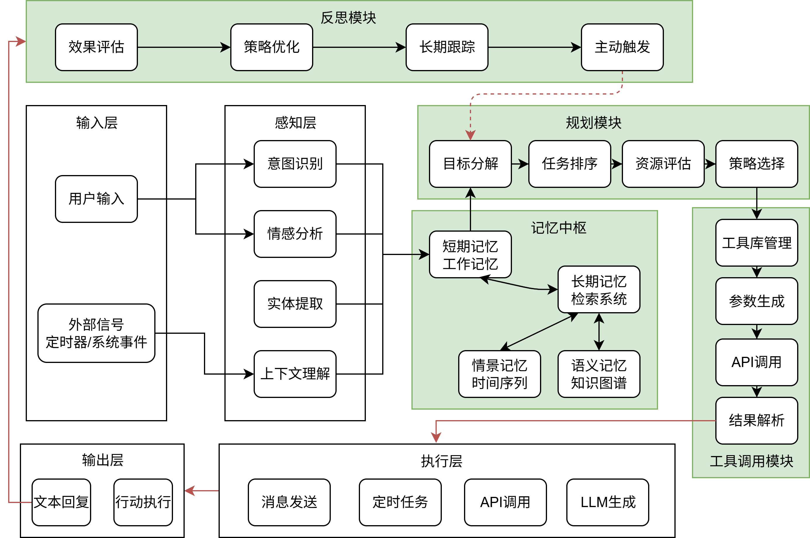
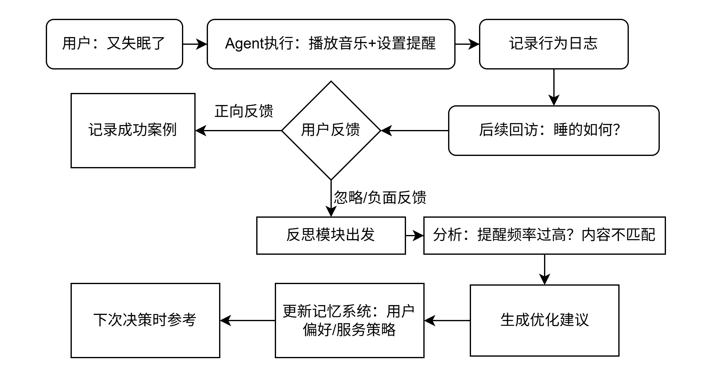

# 什么是Agent

## 一句话定义

OpenAI 在白皮书里给出了严谨的定义：**Agents 是能够代表用户自主执行多步任务的系统**。它不仅理解指令，还可以自己决定流程、调用工具、纠正错误，甚至在必要时把控制权交回给用户。

拆开看，这句话里有三个关键词：

- **自主**：流程怎么走，是大模型在现场决定的，不是开发者提前写死的。
- **多步**：不是一问一答，而是"行动 → 观察结果 → 再行动"的连续过程。
- **代表用户**：它服务于一个目标，目标达成（或搞不定）才算结束。

所以 Agent 的本质一句话就能说清：**赋予大模型使用工具、采取行动的能力的开发范式**。大模型不再只会生成文本，而是能查询数据库、调用 API、创建图表、发送邮件、检索和处理文档——这大大扩展了 AI 应用的范围和价值。

## 从一个对比理解 Agent

**普通聊天机器人**：一问一答。你说"我最近睡不好"，它回你"你可以试试冥想"——到此为止。

**Agent**：拿到目标后，它会自己跑一个循环：

1. **感知**：识别出这是睡眠问题 + 持续性 + 情绪低落。
2. **规划**：判断要不要查历史睡眠记录、要不要建议专业咨询、要不要设置提醒。
3. **行动**：查询用户日志、调用冥想音频接口、发送每日晚安提醒。
4. **反思**：一周后回访，"你最近睡眠有改善吗？需要调整建议吗？"

这个 **"感知 → 规划 → 行动 → 反思"** 的循环，就是 Agent 的心脏，通常称为 **Agent Loop**。后面讲架构时的记忆、规划、反思模块，都是围绕这个循环展开的。

## Agent 不是 Workflow：一条分界线

Anthropic 在《Building Effective Agents》里给出过一个很有用的区分：

- **Workflow（工作流）**：代码把流程**提前写死**，大模型只在固定的节点上被调用。流程是确定的，可预测，但不够灵活。
- **Agent（智能体）**：大模型**自己掌握流程的主动权**——动态决定用哪些工具、走几步、什么时候结束。灵活，但成本和不确定性更高。

判断标准一句话：**这个流程是否超出了传统自动化的范畴？** 如果流程可以写死，就用 Workflow；只有当"下一步做什么"必须由模型临场判断时，才值得上 Agent。

## 平台视角：Agent 应用是怎么搭起来的

以一个 Agent 平台里的客服助理为例。助理不是只有聊天能力，它还自带客服业务能力——用户跟它聊天，就是在跟一个客服聊天。你还可以扩展它的能力，比如自动识别订单号、发起退款流程。

退款要用到私有数据库；而搜索这类公有能力，靠的是平台的**插件**（比如 Google Web Search 插件、Database 插件）。Agent 平台开发效率高，就是因为提供了大量现成的插件能力和多种大模型的接入能力。


助理可以看作 Agent 应用的**界面**，你其实就是在和大模型聊天，只不过在你和大模型之间还有一个代理程序——它就是 Agent。可以把 Agent 看作**大模型的代理人**。

平台里还有一个重要概念是**工作流**：助理负责识别业务意图并调取对应的工作流，一个工作流就是一个既有业务的逻辑（比如退货流程）。工作流是被助理"调用"的，属于被动配合的角色。

把这几个概念串起来，从外到内一共四层：

> **助理 → 工作流 → 插件 → 知识库**

用传统软件的类比来理解：

| Agent 概念 | 传统软件类比 |
|---|---|
| 工作流 | 独立功能的函数或小程序 |
| 插件 | 系统库函数 |
| 知识库 | 数据库 |

Agent 底层的架构流程图：


## 一个合格的 Agent 要具备什么

总结下来，一个 Agent 要具备以下特性：

- 利用 LLM 来管理工作流、做决策。
- 能判定工作流是否完成。
- 能遇错就中断或回退，并邀请人工干预。
- 拥有访问外部工具（APIs、数据库、服务等）的能力。

## 代理层的核心：意图识别怎么实现

Agent 代理层的核心有两点：

- 一是基于上下文的**用户意图识别**；
- 二是**调用自定义的工作流**完成业务逻辑。

意图识别和参数识别的具体实现有两种路线：**提示词**或**微调**，思想是相通的——都是在引导大模型做决策。

- **提示词**：实施简单、成本低、易于更新，适合快速起步；但在复杂场景下可能不够精准。
- **微调**：整合性更好、判断更准、上下文理解更广，但成本高、有更新和过拟合的风险。

两者的详细对比和实操方法，放在《3. Agent智能体四要素》里展开，这里只需记住一个结论：**提示词解决不了的问题，再用微调去解决**。

## Agent 的适用场景

OpenAI 白皮书里明确提出：只有在以下几类场景下，Agent 才是真正有意义的选择：



作为对比，**不适合**用 Agent 的场景：

- 纯粹的简单操作（如定时发邮件）。
- 完全确定性、可写死判断的流程。
- 对资源敏感、成本极度考究的场景。

先问自己"这个流程是否超出了传统自动化的范畴"，答案是"是"，才值得用 Agent。

## 整体架构：三大模块支撑 Agent Loop



### 记忆中枢：让它"记得住"

- **短期记忆**：最近几轮对话，用于上下文感知。
- **长期记忆**：用户偏好、人格标签、关键事件，用于个性化服务。
- **行为记忆**：工具调用记录、反思日志、目标进度，用于智能规划和优化。

通过这三层记忆，Agent 不仅能记住你说过的话，还能记住它为你做过的事，以及哪些做得好、哪些需改进。

"做得好不好"不是凭空的主观判断，而是**系统化的反思机制 + 记忆系统 + 用户反馈信号**三者协同的结果——整个判断过程就是"感知 → 行动 → 反思 → 优化"的闭环。



### 规划模块（Planner）：让它"想清楚再做"

规划是 Agent 的"战略层"，负责把模糊目标转化为可执行的任务序列。

以"帮助用户改善睡眠"为例，Planner 的工作流程：

1. **目标解析**：用户说"我最近总是失眠"，解析出目标——"改善睡眠质量"。
2. **任务拆解**：
   - 是否已有睡眠日志？→ 查询记忆系统
   - 最近是否有压力事件？→ 分析情绪趋势
   - 是否需要专业建议？→ 判断严重程度
   - 是否提供放松资源？→ 调用冥想库
3. **路径选择**：根据用户性格（如内向型）、历史偏好（曾点赞过轻音乐），决定优先推荐"白噪音 + 呼吸练习"。

### 反思模块（Reflector）：让它"吃一堑，长一智"

反思是 Agent 持续进化的保障：评估结果、分析失败原因、调整策略，实现自我优化。

例如：

- 用户连续三次忽略冥想提醒 → 反思："提醒方式是否太机械？" → 调整为更温暖的语气或更换时间。
- 用户表达"你说的我不懂" → 反思："术语是否过多？" → 后续对话改用更口语化表达。

可以在每次交互后追加一段反思 Prompt：

```
请回顾刚才的对话：  
1. 用户是否达成目标？  
2. 哪些回应可能引起误解？  
3. 下次遇到类似情况应如何改进？  
请输出优化建议。
```

这些反思结果可存入向量数据库，作为未来决策的参考。

---

## 小结与下一步

回到最初的那句话：Agent = 能自主执行多步任务的大模型系统。它的心脏是"感知 → 规划 → 行动 → 反思"的循环，它的四肢是工具和插件，它的记忆让个性化和优化成为可能。

接下来的篇章会逐个展开：

- 《2. 黄焖鸡点餐例子》——用一个例子串起 Agent 的工作过程。
- 《3. Agent智能体四要素》——规划、记忆、工具、行动四大要素与微调实操。
- 《4. 什么是MCP》——工具调用的标准化协议，Agent 的"通用接口"。
- 《7. Agent Design Patterns》——构建 Agent 的常见设计模式。
