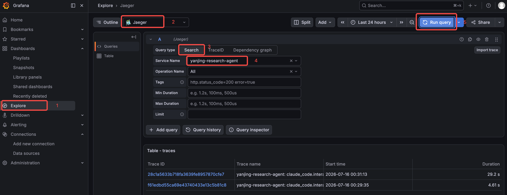

# OpenTelemetry
在公司里做产品时，用户更关心的是监控。比如，开发人员更关心调用链，也就是主 Agent 调用了哪些 SubAgent，SubAgent 又调用了哪些工具等等。通过查看调用链，可以知道问题在哪，瓶颈在哪。

至于领导，最喜欢看带有各种图表指标的监控大盘，了解他的钱花哪去了。Claude Agent SDK 是懂用户，也懂领导的，它准备好了无缝接入 OpenTelemetry 的功能，我们只需要正确配置环境变量，就能把 traces、metrics、log events 统一导出到任意 OTLP 后端。

---

## 理解 OpenTelemetry
可以把它理解成一套“应用体检标准”。它由云原生计算基金会（CNCF）维护，定义了三种核心数据格式.
- Traces（链路）：记录一次请求从头到尾经过了哪些环节、每个环节花了多少时间，以及环节之间的父子关系。把它想象成快递的物流轨迹，你就能知道包裹从发货到签收每一步发生了什么。
- Metrics（指标）：记录可聚合的数值，比如 token 总数、请求次数、错误率、响应时间分位值。把它想象成体检报告里的血压、心率，适合长期趋势分析和告警。
- Log events（日志事件）：记录离散的结构化事件，比如某次 prompt 的提交、某次工具调用的结果、某次 API 错误。把它想象成病历本上的每一次就诊记录。

这三类数据都通过统一的 OTLP（OpenTelemetry Protocol） 协议发送出去，后端可以是 Jaeger、Datadog、Grafana、Honeycomb、Langfuse，也可以是你自己搭建的 collector。对 Agent 应用来说，最大的好处是：我们不需要为每一种监控后端单独写接入代码，配置好 OTLP 端点，所有数据就自动流过去了。

---

## OpenTelemetry 在 SDK 中是如何工作的
Claude Agent SDK 本身并不直接生成遥测数据，而是把配置透传给内部启动的 Claude Code CLI 子进程。CLI 子进程内置了 OpenTelemetry 插桩，会自动记录三种信号。

这里有两个关键点需要注意。
- 第一，总开关是 CLAUDE_CODE_ENABLE_TELEMETRY=1。只有设置了这个变量，后续的信号导出才会生效。
- 第二，Traces 目前处于 beta 阶段，需要额外设置 CLAUDE_CODE_ENHANCED_TELEMETRY_BETA=1。metrics 和 log events 则不需要这个开关。

配置方式有两种：
- 进程环境变量：在 shell、Docker、K8s 中统一设置，所有 query() 调用自动生效。这是生产环境推荐的做法。
- ClaudeAgentOptions.env：为某一次调用单独设置，适合同一进程里不同 Agent 需要不同遥测配置的场景。在 Python 中，env 会与当前进程环境合并。

---

## 实战：接入 OpenTelemetry
新增两部分内容。
- 一个 build_otel_env() 函数，负责构造所有 OpenTelemetry 环境变量；
- 在 run_fresh、run_resume、run_fork 的 ClaudeAgentOptions 中注入 env。

-> /Users/luoji1/code/LLM-Tutorials/catalyst/DevelopFramework/ClaudeAgentSDK/demo/opentelemetry/agent_with_telemetry.py 

### 构造 OpenTelemetry 环境变量
-> build_otel_env()

这段代码有五个层次

1. 总开关与 beta 开关:
CLAUDE_CODE_ENABLE_TELEMETRY=1 是所有信号的前置条件。CLAUDE_CODE_ENHANCED_TELEMETRY_BETA=1 则是开启 Traces 所必需的。

2. exporter 配置:
三种信号可以独立选择 exporter。SDK 推荐统一使用 otlp，即 OpenTelemetry Protocol。

3. OTLP 传输配置:
OTEL_EXPORTER_OTLP_PROTOCOL 设置为 http/protobuf，OTEL_EXPORTER_OTLP_ENDPOINT 指向 collector 地址。这里我用环境变量做兜底，默认本机 4318 端口，方便本地 Jaeger 测试。OTEL_EXPORTER_OTLP_HEADERS 则用于认证，例如 Authorization=Bearer your-token。

4. 服务名与资源属性:
默认服务名是 claude-code。如果你运行多个 Agent，最好在 OTEL_SERVICE_NAME 里给它们各自命名。OTEL_RESOURCE_ATTRIBUTES 可以附加版本号、部署环境等标签，方便在可观测后端按服务筛选。

5. 导出间隔:
CLI 默认 metrics 每 60 秒导出一次，traces 和 logs 每 5 秒导出一次。

### 注入到三种会话模式
build_otel_env() 准备好之后，只需要在三个 ClaudeAgentOptions 里加上 env=otel_env 即可.
-> run_fresh()

run_resume 和 run_fork 的改造方式完全一致，都是在 ClaudeAgentOptions 里加上 env=otel_env or build_otel_env()。

---

### 用户与租户归因
当团队多人共用一个 Agent 服务时，我们需要把每次调用的成本归属到具体的人。OpenTelemetry 支持通过 OTEL_RESOURCE_ATTRIBUTES 注入 enduser.id 和 tenant.id。
```py
parser.add_argument(
    "--user",
    metavar="USER_ID",
    default="",
    help="当前分析师 ID，用于 OpenTelemetry 用户归因",
)
parser.add_argument(
    "--tenant",
    metavar="TENANT_ID",
    default="",
    help="当前租户/团队 ID，用于 OpenTelemetry 用户归因",
)
```
然后在 main() 里调用 build_otel_env(enduser_id=args.user, tenant_id=args.tenant)。enduser.id 和 tenant.id 会出现在每条 span、每个 metric、每个 log event 上，方便后续按人、按团队做成本分摊。

需要注意的是，这些值里如果包含逗号、空格、等号，必须先做 percent-encode，否则会破坏 OTEL_RESOURCE_ATTRIBUTES 的解析。代码里用 urllib.parse.quote 做了处理。

---

### 敏感数据控制
OpenTelemetry 默认只导出演示结构：耗时、模型名、工具名、token 数等。Agent 读取或写入的内容默认不会被记录。但如果你需要更细粒度的审计，可以通过以下变量按需开启：

- OTEL_LOG_USER_PROMPTS=1 在事件和 interaction span 上记录 prompt 文本
- OTEL_LOG_TOOL_DETAILS=1 在 tool_result 事件上记录工具输入参数
- OTEL_LOG_TOOL_CONTENT=1 在 tool span 上以 span event 形式记录完整工具输入输出
- OTEL_LOG_RAW_API_BODIES 记录完整 API 请求 / 响应 JSON

建议，默认不开启这些变量，只有当你的可观测 pipeline 经过安全审批、确实需要内容级审计时，再按需打开。

---

### 测试效果
-> /Users/luoji1/code/LLM-Tutorials/catalyst/DevelopFramework/ClaudeAgentSDK/demo/opentelemetry/otel

使用命令 docker compose up -d 把组件拉起, 这是一份带有 OpenTelemetry 适配器，Prometheus、Jaeger、Grafana 等组件的 docker compose Yaml 文件。

接下来，我们在浏览器输入 http://:3000，输入默认用户名 / 密码，admin/admin，可以打开 Grafana 控制台。


执行后面的命令
```bash
python agent_with_telemetry.py
```

之后在 Grafana 控制台按照下图的步骤编号依次操作。先点击左侧 Explore，之后在上方 Outline 后面的选择框选择 Jaeger。第三步 Query type 选择 Search，之后 Service Name 选择我们在程序中设置的 yanjing-research-agent 这个名称。最后点击右上角的 Run Query，即可搜索到 Trace，并在最下方的 Table-traces 中显示出来。



我们可以在刚才那个面板把 Outline 后面的 Jaeger 换成 Prometheus，就可以查看 Metrics 信息。