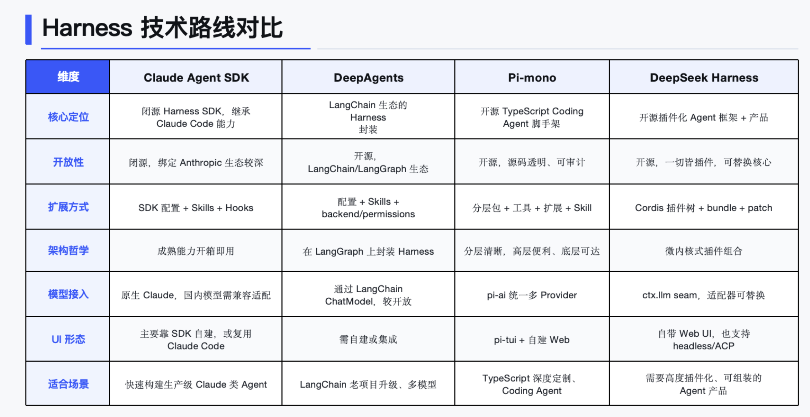

# agent framework history
## 第一阶段:纯工具调用
Agent 开发的热潮兴起于 2023 年，但从技术原理上追溯，最早可以归结为 Function Calling（函数调用）与 ReAct 这两大工具调用机制。

Function Calling 机制由 OpenAI 首创，其核心是将工具文档注册给模型，让模型能够在合适的场景下主动选择合适的工具来解决问题。ReAct 框架的功能与之类似，但它通过提示词的形式，显式地教会了模型“推理（Reasoning）- 行动（Acting）- 观察（Observing）”的完整过程，使得整个链路更加透明且具备可观测性。

但业务场景不断深入，纯工具调用 Agent 的弊端也逐渐显现，最典型的便是“幻觉”问题以及任务完成质量不稳定、难以达到预期效果。

---

## 第二阶段：多种设计模式和脚手架的出现
业界开始探索通过模仿人类解决问题的方式来提升 Agent 的表现，多种 Agent 设计模式应运而生。比如
- 计划模式：先规划出任务执行步骤，让模型严格按照步骤推进。
- 反思模式：设置一个“反思智能体”去审查“执行智能体”的输出，并提出改进意见。
- 人机协作模式：在关键节点中断 Agent 的执行，邀请人类介入提供决策。
- 多 Agent 模式：按照任务或角色划分出子 Agent，由一个管理员 Agent 统一调度。

伴随着这些设计模式的出现，AutoGPT、CrewAI 等新的 Agent 开发脚手架也大量涌现。这个阶段，开发者的工作量又加大了，因为需要分出大量精力去研究和适配这些复杂的设计模式。

---

## 第三阶段：工作流与 LangGraph
在引入了多种设计模式后，大家发现整个 Agent 系统最薄弱的一环依然是模型本身的能力。有时很难仅凭一套提示词就 100% 约束模型的行为，任务的输出步骤和结果依然充满不确定性。为了尽量减少这种情况，让 Agent 系统能够尽量按照人类预设的步骤运行，于是“工作流模式”开始流行。

这种模式的核心思想是将任务步骤用“节点”来表示，然后用一条“流水线”将这些节点串联起来。在这种架构下，模型只存在于节点之上，专注于完成该节点内具体的小任务；而“下一步该怎么做”的决策权，不再完全交给模型，而是由人类通过工作流流水线强行接管。

对于普通开发者，使用 Coze 与 Dify 等平台都可以通过拖拉拽的方式完成工作流编排。但对于需要写代码的 Agent 工程师，LangGraph 才是编排工作流的神器。

---

## 第四阶段（当前）：从上下文工程到 Harness 工程
从 2025 年开始，“上下文工程”这一概念得到了业界的广泛关注。开发者们意识到，在之前的 Agent 构建过程中，无论使用何种设计模式，本质都是在尽可能地为模型提供丰富的上下文以辅助解决问题——这便是上下文工程早期的理解，聚焦于上下文的构建。

然而随着实践深入，大家发现不可能无限制地为模型堆砌上下文：一方面模型的上下文窗口容量有限；另一方面，当对话轮次过多后，模型会越来越偏离最初的目标。因此，上下文工程的另一个方向——“上下文管理”被更加重视，诸如渐进式加载、上下文压缩、记忆工程等成为了新的研究热点。

到了 2025 年下半年，Claude Code、OpenCode 等编程工具开始火爆。许多人在体验了其强大且丝滑的 AI 编程能力后，开始深入研究其 Agent 系统的设计：为什么它能够连续稳定运行几十分钟、甚至几个小时？为什么能够浏览大型代码库而不会撑爆模型的上下文窗口？为什么仅使用几个简单的基础工具，就能成为操作系统级的 AI 编程助手？此外随着 Skills 概念的火爆，很多人逐渐意识到，原来 Claude Code 不仅能用来编程，配合业务相关的 Skills，它完全可以胜任写 PPT 等其他工作。

进入 2026 年，一个全新的概念横空出世，这便是 Harness Engineering。它通过  Agent = Model + Harness  的公式向我们揭示了一个本质：自 2023 年以来，大家做的各种各样的 Agent 设计，本质上都是为了让 Model 的输出更加稳定，因此这些都属于 Harness 的范畴。

Claude Code、OpenClaw（其底层 Agent 是 Pi-Mono）被公认为是在 Harness 部分实现得极其出色的 Agent。它们都拥有自己的 SDK，可以非常方便地直接构建自带 Harness 的 Agent。近期 LangChain 推出的 DeepAgents，也是在 LangChain、LangGraph 脚手架的基础上，融合了 Harness 的思想，构成了新一代的 Agent 脚手架。

---

## Agent开发本质
对于“Agent 开发本质上是在开发什么？”这个问题已经有了清晰的答案。核心就在于，我们应当将主要精力聚焦于业务开发本身，例如提示词（Prompt）、工具（Tools）以及 Skills 的打磨与优化。而当我们的 Agent 系统表现出不稳定性时，再去针对性地运用工程化手段对其进行调优。

---

##  Claude Agent SDK、DeepAgents、Pi-mono、dsh 的对比

> 此外还有一条不同的路线：Smolagents 用约一千行代码从零手写 Agent Loop，并以 CodeAct 范式（让模型写代码而非逐个调工具）见长。它更像学习路径上的起点，而非上述四者的同层竞品，详见下文"如何选择"。

---

## 如何选择？

上面几个框架并不是同一维度上的竞品，也不是"谁更强"的关系。选型时最常见的误区是：默认自己一定需要一个 Harness，然后在这几个名字里挑一个。实际上，真正决定结果的是**你的业务本身**——在讨论"用哪个框架"之前，应该先过四道过滤器。

### 第一道：你的业务流程可以枚举吗？

这是最重要、也最容易被跳过的一道。

如果业务步骤是确定的、可以穷举的（比如固定格式的研报生成、固定清单的合同条款审查），那么诚实的答案是：**你不需要 Agent Loop，你需要工作流**。用 LangGraph 或普通代码把节点串起来，每一步的模型只负责该步骤内的一个小任务，可测性、可回归性、单步成本全都可控。在这种场景里，Agent 的不确定性是纯粹的负担。

只有当"下一步做什么"本身就需要模型根据现场情况动态决定时，Harness 的价值才真正体现出来。本系列的《Claude Agent SDK》《Deepagents》《Pi-mono》几篇，选的都是后者——这也是它们有存在意义的前提。

### 第二道：语言栈

| 框架 | 语言 |
| :--- | :--- |
| Smolagents | Python |
| Claude Agent SDK | Python / TypeScript |
| DeepAgents | Python |
| Pi-mono | TypeScript |
| dsh | Node.js / TypeScript |

团队的主力语言通常是一票否决项。如果团队是 Java / Go / C++，这五个里没有一个是原生选项——那现实的选择是先确认"要不要用 Python 写一层薄 Agent，把编排放在别的语言里"，或者干脆退回上一道题，走工作流路线。

### 第三道：模型供应商受不受限

| 框架 | 模型约束 |
| :--- | :--- |
| Claude Agent SDK | 走 Anthropic 协议端点。国产模型需要改环境变量接兼容端点，且工具调用 API 变更频繁（本系列就被迫锁定 0.1.62，见文末说明） |
| DeepAgents | 对外只有 DeepSeek 能用 `provider:model` 的简洁写法，其余国内模型需退回 LangChain 的 `ChatOpenAI` |
| Pi-mono | `pi-ai` 层统一了各家 Provider，OpenAI 兼容接口即可接入，是这几个里最宽容的 |
| Smolagents | 走 LiteLLM，换模型几乎零成本 |
| dsh | 模型适配器本身就是插件，换 provider 不需要动框架 |

### 第四道：你能接受多少自维护成本

真正的判断维度是：**当 Agent Loop 的行为不符合预期时，你能不能自己进去改。**

- **Claude Agent SDK**：不能改，只能等官方。但反过来说，升级和修 bug 也都由官方兜底。
- **DeepAgents**：能改，但要读懂 LangGraph 的运行时。
- **Pi-mono**：能改，源码就在本地，逐行跟进去看循环怎么调 LLM、工具怎么执行；代价是你自己接手了长期维护。
- **dsh**：能改，而且 Agent Loop 本身就是插件——但它目前处于开发者预览阶段，npm 上部分包的 latest 标签还指向坏版本（详见 `dsh.md`）。
- **Smolagents**：本来就只有一千行左右的源码，天然可读可改。

### 五者的定位

| 框架 | 一句话定位 | 适合 | 不适合 |
| :--- | :--- | :--- | :--- |
| Smolagents | 千行级手写 Agent Loop，CodeAct 范式 | 学习与原型；数据分析、代码类任务；想彻底搞懂 Agent Loop 内部机制 | 长任务、需要上下文管理与护栏的生产场景 |
| Claude Agent SDK | 闭源但开箱即用度最高的 Harness | 追求最快上线；用 Claude 模型；需要成熟的上下文压缩与 Skills/Hooks | 需要深度定制 Loop；被模型厂商绑定；版本滞后 |
| DeepAgents | LangChain 团队的 Harness 实现 | 团队已有 LangChain 积累，但想要 Agent 形态而非图形态 | 核心资产是编排拓扑（复杂状态图）的团队 |
| Pi-mono | 分层清晰、源码透明的 TS 框架 | TypeScript 团队；要自定义压缩策略、循环与终端 UI | Python 团队；不愿承担长期维护责任 |
| dsh | Cordis 插件树驱动的"一切皆插件"运行时 | 研究插件化 Agent 架构；写插件练手 | 生产选型（预览阶段，生态与发布流程尚不稳定） |

关于 **Smolagents**，它值得单独说一句：它是这几个里唯一"从零手写 Agent Loop"的框架（核心逻辑仅约 1000 行），也提供了一条与其余框架都不同的技术路线——**CodeAct**，即让模型写代码而不是逐个调用工具。这既省工具数量，又省上下文，所以在数据分析这类"代码不固定、边写边改"的场景里格外有效。但它恰恰缺少上下文管理、长期记忆、反思机制和安全护栏这些 Harness 组件。所以它不是上面四者的竞争者，而是**学习路径上的第一站**与特定场景下的轻量选项。

### 把选型与框架解耦

这一条直接对应上面"Agent 开发本质"那节的结论：真正该投入的是提示词、工具和 Skills，而不是框架。

所以更稳妥的做法是**两层解耦**：

- **业务层**：把业务能力沉淀成 MCP Server 与 Skills。这层是可移植的——Claude Agent SDK、DeepAgents、Pi-mono、Smolagents 都支持接入 MCP，Skills 的格式也正在跨框架趋同。
- **框架层**：Harness 本身是可替换的。Agent Loop、上下文压缩策略、沙箱机制都在快速演进，今天的最佳实践两年后大概率要重写。

按这个顺序做，即使选错框架，业务资产也不会跟着一起报废。

### 速查

四道题都过了之后，再回到最初那个问题：

- 想最快拿到 Claude Code 级别的能力 → **Claude Agent SDK**（前提：用 Claude 模型、接受闭源与版本滞后）
- 团队已有 LangChain/LangGraph 积累，但想要 Agent 形态 → **DeepAgents**
- 已经用 LangGraph 搭了复杂编排拓扑 → **留在 LangGraph**，不必迁到 DeepAgents
- TypeScript 团队 + 想深度定制循环和 UI → **Pi-mono**
- 数据分析/科学计算为主，或想从零理解 Agent Loop → **Smolagents**
- 相信 Agent 能力应该像 VS Code 插件一样可插拔 → **dsh**（当前定位是研究与练手，暂不建议作为生产底座）

> **Claude Agent SDK 版本说明**：当前 `ClaudeAgentSDK/1. Claude Agent SDK.md` 锁定的 `claude-agent-sdk==0.1.62` 是为兼容国产模型（避免调用工具时 400 bad request）的临时回退；上游 2026-09 已迭代到 0.3.x / 0.4.x。仅当确认国产模型厂商已跟进新 API 后，再按 `0.4 → 0.3 → 0.2 → 0.1.62` 的顺序回退验证。

---

## 配套代码
https://github.com/worldluoji/harness-cli-learning